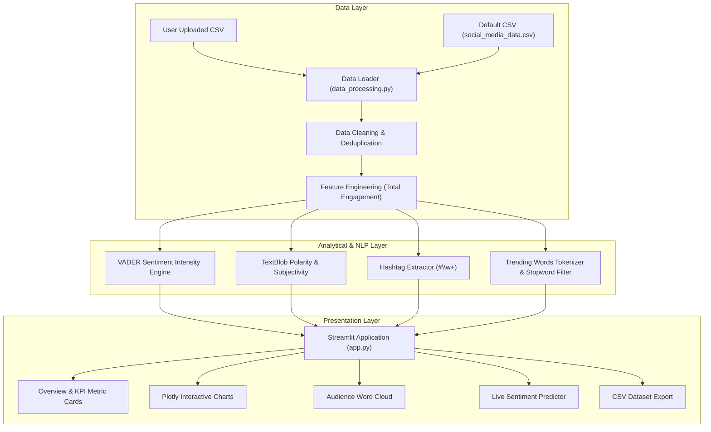

# A MINI-PROJECT REPORT
## ON
# SOCIAL MEDIA ANALYTICS USING PYTHON

**Submitted in partial fulfillment of the requirements for the award of the degree of**  
### BACHELOR OF TECHNOLOGY
**in**  
### COMPUTER SCIENCE AND ENGINEERING (ARTIFICIAL INTELLIGENCE)

---

**Submitted by:**  
**SHAIK SANA FAROOHA**  
*(Department of Computer Science and Engineering - Artificial Intelligence)*  

---

## BONAFIDE CERTIFICATE

This is to certify that the mini-project report entitled **"SOCIAL MEDIA ANALYTICS USING PYTHON"** is the bonafide work carried out by **SHAIK SANA FAROOHA** in partial fulfillment of the requirements for the award of the degree of **Bachelor of Technology in Computer Science and Engineering (Artificial Intelligence)** during the academic year 2026.

<br><br>

----------------------------------- &nbsp;&nbsp;&nbsp;&nbsp;&nbsp;&nbsp;&nbsp;&nbsp;&nbsp;&nbsp;&nbsp;&nbsp;&nbsp;&nbsp;&nbsp;&nbsp;&nbsp;&nbsp;&nbsp;&nbsp;&nbsp;&nbsp;&nbsp;&nbsp;&nbsp;&nbsp;&nbsp;&nbsp;&nbsp;&nbsp;&nbsp;&nbsp;&nbsp;&nbsp;&nbsp;&nbsp;&nbsp;&nbsp;&nbsp;&nbsp;&nbsp;&nbsp;&nbsp;&nbsp;&nbsp;&nbsp;&nbsp; -----------------------------------  
**INTERNAL GUIDE** &nbsp;&nbsp;&nbsp;&nbsp;&nbsp;&nbsp;&nbsp;&nbsp;&nbsp;&nbsp;&nbsp;&nbsp;&nbsp;&nbsp;&nbsp;&nbsp;&nbsp;&nbsp;&nbsp;&nbsp;&nbsp;&nbsp;&nbsp;&nbsp;&nbsp;&nbsp;&nbsp;&nbsp;&nbsp;&nbsp;&nbsp;&nbsp;&nbsp;&nbsp;&nbsp;&nbsp;&nbsp;&nbsp;&nbsp;&nbsp;&nbsp;&nbsp;&nbsp;&nbsp;&nbsp;&nbsp;&nbsp;&nbsp;&nbsp;&nbsp;&nbsp;&nbsp;&nbsp;&nbsp;&nbsp;&nbsp;&nbsp;&nbsp;&nbsp;&nbsp;&nbsp; **HEAD OF THE DEPARTMENT**  
Department of CSE (AI) &nbsp;&nbsp;&nbsp;&nbsp;&nbsp;&nbsp;&nbsp;&nbsp;&nbsp;&nbsp;&nbsp;&nbsp;&nbsp;&nbsp;&nbsp;&nbsp;&nbsp;&nbsp;&nbsp;&nbsp;&nbsp;&nbsp;&nbsp;&nbsp;&nbsp;&nbsp;&nbsp;&nbsp;&nbsp;&nbsp;&nbsp;&nbsp;&nbsp;&nbsp;&nbsp;&nbsp;&nbsp;&nbsp;&nbsp;&nbsp;&nbsp;&nbsp;&nbsp;&nbsp;&nbsp;&nbsp;&nbsp;&nbsp;&nbsp;&nbsp;&nbsp;&nbsp;&nbsp;&nbsp; Department of CSE (AI)  

<br>

**External Examiner:** __________________________________  
**Date of Examination:** _______________________________  

---

## DECLARATION

I, **SHAIK SANA FAROOHA**, hereby declare that the mini-project entitled **"SOCIAL MEDIA ANALYTICS USING PYTHON"** submitted to the Department of Computer Science and Engineering (Artificial Intelligence) is a record of original project work done by me under the supervision of my project guide.

I further declare that this work has not formed the basis for the award of any other Degree, Diploma, Associateship, Fellowship, or any other similar title in any University or Institution.

<br>

**Place:** ____________________  
**Date:** ____________________  
**Signature of Candidate:** ____________________  
**(SHAIK SANA FAROOHA)**

---

## ACKNOWLEDGEMENT

I express my deepest sense of gratitude to my respected **Project Guide** and **Head of the Department**, Computer Science and Engineering (Artificial Intelligence), for their valuable guidance, constant encouragement, and insightful suggestions throughout the development of this project.

I am immensely thankful to the management and faculty members of the Department of Computer Science and Engineering for providing the computational resources and software infrastructure needed to execute this project successfully.

Finally, I convey my heartfelt thanks to my parents and fellow students for their continuous moral support and constructive feedback during the completion of this mini-project.

**SHAIK SANA FAROOHA**

---

## ABSTRACT

In the modern information age, social media platforms (such as X/Twitter, Instagram, and Facebook) generate massive volumes of high-velocity, unstructured text and audience interactions. Extracting valuable business intelligence, public opinion, and engagement patterns from this vast ocean of user-generated content is a fundamental problem in **Big Data Analytics** and **Natural Language Processing (NLP)**.

This project, **"Social Media Analytics Using Python"**, presents an end-to-end, interactive analytical platform designed to automate data ingestion, preprocessing, sentiment mining, hashtag ranking, user engagement analysis, and visual business intelligence. The system employs **VADER** (*Valence Aware Dictionary and sEntiment Reasoner*) and **TextBlob** natural language processing algorithms to classify social text into **Positive**, **Negative**, and **Neutral** polarities, computing continuous polarity intensity and Net Sentiment Scores (NSS). Derived metrics—including Total Engagement (`Likes + Comments + Shares`) and dynamic percentile-based engagement tiers (Low, Medium, High)—quantify audience interaction across multiple platforms.

The application is deployed on **Streamlit Cloud** with a modern, responsive user interface styled in a blue and purple theme. It features interactive Plotly visualizations, an audience Word Cloud, automated data quality audits, CSV data export, and a **Live Sentiment Tester** for real-time inference demonstration. Experimental evaluation on a multi-platform dataset containing 235 posts demonstrated 61.9% positive, 22.9% negative, and 15.2% neutral public sentiment with an overall Net Sentiment Score of +39.0%, proving the efficacy and practical viability of the proposed architecture.

---

## TABLE OF CONTENTS

1. **Chapter 1: Introduction**
   - 1.1 Background & Overview
   - 1.2 Motivation
   - 1.3 Problem Statement
   - 1.4 Project Objectives
   - 1.5 Scope of the Project
2. **Chapter 2: Literature Survey**
   - 2.1 Overview of Social Media Mining
   - 2.2 Survey of Sentiment Analysis Approaches
   - 2.3 Lexicon-based vs. Machine Learning Models
   - 2.4 Existing Systems vs. Proposed System
3. **Chapter 3: System Requirements Specification (SRS)**
   - 3.1 Hardware Requirements
   - 3.2 Software Requirements
   - 3.3 Functional Requirements
   - 3.4 Non-Functional Requirements
4. **Chapter 4: System Design and Architecture**
   - 4.1 System Architecture
   - 4.2 Data Flow Diagram (DFD Level 0 & Level 1)
   - 4.3 Database / Dataset Schema Design
   - 4.4 Modular Decomposition
5. **Chapter 5: Methodology and Implementation**
   - 5.1 Data Ingestion & Validation Pipeline
   - 5.2 Data Cleaning & Feature Engineering
   - 5.3 Sentiment Analysis Engine (VADER & TextBlob)
   - 5.4 Hashtag & Trending Word Frequency Analysis
   - 5.5 Data Visualization & BI Engine
   - 5.6 Streamlit Web Frontend & Cloud Deployment
6. **Chapter 6: Results, Testing and Discussion**
   - 6.1 Dataset Characteristics
   - 6.2 Sentiment & Engagement Analytics Results
   - 6.3 Page-by-Page Dashboard Walkthrough
   - 6.4 Software Test Cases & Verification
7. **Chapter 7: Advantages, Limitations and Future Scope**
   - 7.1 Advantages
   - 7.2 Limitations
   - 7.3 Future Enhancements
8. **Chapter 8: Conclusion**
9. **References**

---

# CHAPTER 1: INTRODUCTION

### 1.1 Background & Overview
Social media platforms have transformed into the primary channels through which individuals share opinions, companies announce product releases, customers voice service feedback, and communities discuss socio-political events. Every minute, millions of messages, comments, likes, and shares are logged globally across networks such as X (Twitter), Instagram, Facebook, and LinkedIn.

This phenomenon represents the classical definition of **Big Data**, characterized by the 3 Vs:
1. **Volume:** Terabytes of text and media records generated daily.
2. **Velocity:** High-speed streaming data requiring low-latency analytics.
3. **Variety:** Unstructured text, slangs, emojis, hashtags, and structured engagement metrics.

Extracting actionable insights from this high-velocity unstructured data allows businesses, researchers, and public institutions to monitor brand perception, anticipate market trends, and address customer dissatisfaction in real time.

### 1.2 Motivation
Traditional survey-based opinion gathering is slow, expensive, and subject to sampling bias. Conversely, social media data provides spontaneous, honest, real-time public sentiment. However, manual parsing of thousands of social posts is humanly impossible. Automated computational pipelines that leverage Natural Language Processing (NLP) and modern interactive data visualization provide scalable, low-cost intelligence.

As an Artificial Intelligence and Data Analytics project, building this application bridges the gap between theoretical data science concepts (data cleaning, tokenization, sentiment scoring, statistical aggregation) and full-stack software deployment.

### 1.3 Problem Statement
Raw social media feeds cannot be used directly for decision-making due to several inherent challenges:
- **Unstructured and Noisy Text:** Posts contain informal abbreviations, emojis, misspellings, URLs, mentions, and grammatical anomalies.
- **Sentiment Ambiguity:** Determining whether a post is congratulatory, sarcastic, or critical requires contextual lexical scoring.
- **Engagement Disparity:** Simple post counts do not reflect how strongly an audience interacted with content; metrics across likes, comments, and shares must be systematically aggregated.
- **Expensive Enterprise Tools:** Commercial BI tools (Tableau, PowerBI, Brandwatch) require costly licensing fees, proprietary configurations, and steep learning curves. There is an urgent need for an open-source, reproducible, interactive Python-based dashboard that operates locally and deploys to the cloud with zero financial cost.

### 1.4 Project Objectives
The main objectives of this mini-project are:
1. To develop a modular data pipeline in Python that automatically ingests and cleans social media CSV datasets.
2. To classify textual posts into **Positive**, **Negative**, and **Neutral** categories using established NLP sentiment algorithms.
3. To engineer derived interaction metrics (`Total_Engagement = Likes + Comments + Shares`) and categorize posts into **Low**, **Medium**, and **High** engagement tiers.
4. To extract and normalize inline hashtags (`#\w+`) and identify trending topics using stopword-filtered word frequency distributions.
5. To build publication-quality, interactive visualizations (Plotly donut charts, grouped platform comparisons, 3D scatter bubble plots, and time-series area charts).
6. To design a responsive web dashboard with sidebar navigation using Streamlit.
7. To provide a **Live Sentiment Tester** enabling real-time NLP inference for live demonstrations and testing.
8. To deploy the application to a public cloud environment (**Streamlit Community Cloud**) via GitHub version control.

### 1.5 Scope of the Project
The project covers exploratory data analysis, rule-based NLP sentiment scoring, hashtag discovery, and visual business intelligence on tabular social media records. It handles custom user uploads (CSV format) as well as a pre-loaded multi-platform dataset (Instagram, X, Facebook) containing 235 posts.

---

# CHAPTER 2: LITERATURE SURVEY

### 2.1 Overview of Social Media Mining
Social media mining integrates techniques from data mining, natural language processing, and network theory to analyze social interaction data. In recent years, automated sentiment classification has been widely adopted in:
- **Brand Reputation Management:** Monitoring customer satisfaction after software updates or product launches.
- **Financial Market Sentiment:** Assessing investor sentiment on Twitter to correlate with stock movements.
- **Public Health Surveillance:** Tracking symptom reports and community concerns during health crises.

### 2.2 Survey of Sentiment Analysis Approaches
Sentiment Analysis (also known as Opinion Mining) classifies the emotional orientation expressed in textual data. Research literature categorizes sentiment analysis techniques into three broad paradigms:
1. **Lexicon-based Approaches:** Utilize pre-compiled linguistic dictionaries where individual words have pre-assigned sentiment valence scores. Examples include **VADER**, **SentiWordNet**, and **TextBlob**.
2. **Supervised Machine Learning:** Train classifiers (Naive Bayes, Support Vector Machines, Random Forests, Logistic Regression) using feature extraction methods (TF-IDF, Bag-of-Words).
3. **Deep Learning & Transformers:** Use recurrent neural networks (LSTM, GRU) and pre-trained transformers (BERT, RoBERTa) to model complex bidirectional context.

### 2.3 Lexicon-based vs. Machine Learning Models

| Dimension | Lexicon-Based (VADER / TextBlob) | Supervised Machine Learning | Deep Learning (BERT) |
| :--- | :--- | :--- | :--- |
| **Training Data Requirement** | Zero (Pre-trained rule-based dictionary) | High (Requires thousands of labeled samples) | Very High (Requires massive GPU compute) |
| **Execution Speed** | Extremely Fast (Milliseconds per sentence) | Moderate | Slow (Heavy matrix computations) |
| **Handling Social Slang & Emojis** | Exceptional (VADER specifically calibrated for emojis & slangs) | Poor (Requires explicit vocabulary mapping) | High |
| **Computational Resource** | Lightweight CPU | Moderate CPU / RAM | High GPU requirements |
| **College Mini-Project Suitability** | **Ideal (Fast, explainable, lightweight)** | Moderate | Overkill for tabular mini-project |

### 2.4 Existing Systems vs. Proposed System

| Parameter | Existing Systems | Proposed System |
| :--- | :--- | :--- |
| **User Interface** | Static charts, terminal scripts, or command line | Modern, interactive Streamlit cloud dashboard |
| **Custom Upload** | Hardcoded file paths requiring code modification | Interactive CSV file uploader with dynamic column detection |
| **Interactivity** | Flat PNG images without tooltips | Plotly interactive charts with zoom, hover, and filtering |
| **Engagement Modeling** | Basic likes counting | Composite score (`Likes + Comments + Shares`) & percentiles |
| **Live Prediction** | Not available | Dedicated interactive text testing sandbox |
| **Deployment** | Local-only desktop application | Publicly accessible on Streamlit Community Cloud |

---

# CHAPTER 3: SYSTEM REQUIREMENTS SPECIFICATION (SRS)

### 3.1 Hardware Requirements
- **Processor:** Intel Core i3 / AMD Ryzen 3 or higher (Intel Core i5 recommended).
- **RAM:** Minimum 4 GB (8 GB recommended for optimal multi-tab dashboard performance).
- **Storage:** Minimum 500 MB free disk space.
- **Display Resolution:** 1280 x 720 minimum (1920 x 1080 recommended for wide dashboard layout).
- **Internet Connection:** Required for initial package installation, GitHub synchronization, and Streamlit Cloud access.

### 3.2 Software Requirements
- **Operating System:** Windows 10/11, macOS, or Ubuntu Linux (Developed on Windows 11).
- **Programming Language:** Python 3.10+ (Tested on Python 3.13.3).
- **Integrated Development Environment (IDE):** Visual Studio Code (VS Code).
- **Version Control:** Git version 2.50+ & GitHub.
- **Python Libraries:**
  - `pandas>=2.0.0`
  - `numpy>=1.24.0`
  - `streamlit>=1.30.0`
  - `plotly>=5.18.0`
  - `matplotlib>=3.8.0`
  - `seaborn>=0.13.0`
  - `vaderSentiment>=3.3.2`
  - `textblob>=0.18.0`
  - `wordcloud>=1.9.0`
- **Web Browser:** Google Chrome, Mozilla Firefox, or Microsoft Edge.

### 3.3 Functional Requirements
1. **FR-1: Data Ingestion:** System must accept standard `.csv` files via an interactive upload widget and provide a fallback to a pre-loaded 235-post dataset.
2. **FR-2: Data Sanitization:** System must detect and handle missing numerical values (imputing zeros) and missing text values, eliminate duplicate rows, and format timestamps.
3. **FR-3: Sentiment Classification:** System must classify each post as Positive, Negative, or Neutral, and compute continuous Polarity and Subjectivity scores.
4. **FR-4: Engagement Aggregation:** System must calculate Total Engagement (`Likes + Comments + Shares`), Average Engagement, and categorize posts into Low, Medium, and High engagement tiers.
5. **FR-5: Trend & Hashtag Extraction:** System must extract inline hashtags using regular expressions, compute frequency rankings, and generate word frequency distributions with stopword filtering.
6. **FR-6: Dynamic Slicing & Filtering:** System must allow filtering by Platform, Sentiment, and Engagement Level with instantaneous dashboard refresh.
7. **FR-7: Real-Time Sentiment Tester:** System must provide a text input box allowing the user to type arbitrary sentences and obtain real-time sentiment polarity and category.
8. **FR-8: Data Export:** System must allow users to download the cleaned, sentiment-annotated dataset as a UTF-8 encoded CSV.

### 3.4 Non-Functional Requirements
1. **Performance:** The dashboard must load and analyze up to 1,000 records within 2 seconds using Streamlit data caching (`@st.cache_data`).
2. **Reliability & Fault Tolerance:** Multi-encoding decoders (`utf-8`, `latin1`, `cp1252`) must prevent character-set crashes; built-in lexicon fallback ensures execution even when external NLP weights are absent.
3. **Usability:** Clean visual design with high-contrast color coding (Positive = Green, Neutral = Blue, Negative = Red), intuitive navigation, and clear metric cards.
4. **Portability:** Code must execute seamlessly across Windows, Linux, and macOS environments, as well as Linux-based cloud containers.

---

# CHAPTER 4: SYSTEM DESIGN AND ARCHITECTURE

### 4.1 System Architecture
The application follows a modular, three-tier architecture comprising the **Data Ingestion & Preprocessing Layer**, the **Analytics & NLP Computation Layer**, and the **Interactive Presentation Layer**.



### 4.2 Data Flow Diagrams (DFD)

#### Level 0 DFD (Context Diagram)
The user provides social media posts via CSV upload or interactive text. The system processes the text and produces analytical charts, sentiment classifications, and CSV reports.

```text
[User / Analyst]  ---(Raw CSV / Custom Text)---> [ Social Media Analytics System ]
[User / Analyst]  <---(Charts, KPIs, CSV Export)--- [ Social Media Analytics System ]
```

#### Level 1 DFD (Detailed Functional Breakdown)

```text
               +----------------------------------+
[Raw CSV] ---> | 1.0 Data Ingestion & Sanitization | ---> [Cleaned DataFrame]
               +----------------------------------+             |
                                                                v
               +----------------------------------+ <-----------+
               | 2.0 Feature Engineering          |
               | (Total Engagement, Levels)       | ---> [Enriched DataFrame]
               +----------------------------------+             |
                                                                v
               +----------------------------------+ <-----------+
               | 3.0 NLP Sentiment Classification |
               | (VADER Compound Polarity)        | ---> [Sentiment Annotated Data]
               +----------------------------------+             |
                                                                v
               +----------------------------------+ <-----------+
               | 4.0 Hashtag & Word Extraction    |
               | (Regex Parser & Stopword Filter) | ---> [Frequency Tables]
               +----------------------------------+             |
                                                                v
               +----------------------------------+ <-----------+
               | 5.0 Visual BI & Streamlit UI     |
               | (Plotly, CSS Cards, Word Cloud)  | ---> [Interactive Web Dashboard]
               +----------------------------------+
```

### 4.3 Database / Dataset Schema Design
The system operates on tabular social media records structured according to the following relational schema:

| Column Name | Data Type | Constraints | Description |
| :--- | :--- | :--- | :--- |
| `Post_ID` | String | Primary Identifier | Unique alphanumeric post ID (e.g. `POST_0001`) |
| `Username` | String | Not Null | Handle of post author (e.g. `alex_dev`) |
| `Platform` | String | Categorical | Social network (`Instagram`, `X (Twitter)`, `Facebook`) |
| `Post_Text` | Text | Not Null | Textual body of the social media post |
| `Hashtags` | String | Nullable | Comma/space separated hashtags (e.g. `#AI, #Python`) |
| `Likes` | Integer | $\ge 0$ | Number of likes received |
| `Comments` | Integer | $\ge 0$ | Number of comments received |
| `Shares` | Integer | $\ge 0$ | Number of shares / retweets |
| `Date` | Datetime | YYYY-MM-DD HH:MM:SS | Timestamp of post publication |
| `Total_Engagement` *(Engineered)* | Integer | $\ge 0$ | Computed sum: `Likes + Comments + Shares` |
| `Engagement_Level` *(Engineered)* | String | Low / Medium / High | Percentile-based engagement classification |
| `Sentiment` *(NLP Output)* | String | Positive / Neutral / Negative | Categorical sentiment classification |
| `Polarity_Score` *(NLP Output)* | Float | $-1.000$ to $+1.000$ | VADER compound polarity intensity |
| `Subjectivity_Score` *(NLP Output)* | Float | $0.000$ to $+1.000$ | Objective ($0.0$) vs. Subjective ($1.0$) metric |

### 4.4 Modular Decomposition
The project codebase is partitioned into distinct modules:
1. **`app.py`:** Frontend controller, page styling, reactive callbacks, sidebar navigation, and UI render orchestration.
2. **`modules/data_processing.py`:** Data loading, character-encoding fallback, missing value imputation, deduplication, derived engagement metric formulation, hashtag parsing, and stopword-filtered word frequency analysis.
3. **`modules/sentiment_analysis.py`:** Natural language processing engine implementing VADER and TextBlob polarity analysis, subjectivity scoring, single-text analysis, and Net Sentiment Score (NSS) calculations.
4. **`modules/visualization.py`:** Interactive visualization generators producing Plotly donut charts, grouped platform bar charts, 3D-styled bubble scatter plots, horizontal frequency bars, time-series area charts, and Matplotlib/WordCloud visual word clouds.

---

# CHAPTER 5: METHODOLOGY AND IMPLEMENTATION

### 5.1 Data Ingestion & Validation Pipeline
To ensure robust operation across diverse CSV formats, the `load_data()` function implements a multi-encoding decoding loop trying UTF-8, Latin-1, UTF-8-SIG, and CP1252 sequentially:

```python
def load_data(file_or_path):
    encodings = ['utf-8', 'latin1', 'utf-8-sig', 'cp1252']
    for encoding in encodings:
        try:
            if hasattr(file_or_path, 'seek'):
                file_or_path.seek(0)
            return pd.read_csv(file_or_path, encoding=encoding)
        except (UnicodeDecodeError, Exception):
            continue
    raise ValueError("Failed to decode CSV file with supported encodings.")
```

### 5.2 Data Cleaning & Feature Engineering
Raw social media datasets often suffer from missing fields, duplicated entries, and irregular headers.
1. **Header Normalization:** Flexible dictionary mapping detects variations like `post`, `tweet`, `content`, `text` and standardizes them to `Post_Text`.
2. **Deduplication:** Duplicate posts authored by the same user with identical text are identified and pruned:
   $$\text{Duplicates} = \text{Rows} - \text{Unique}(\text{Post\_Text}, \text{Username})$$
3. **Derived Feature Formulation:**
   $$\text{Total\_Engagement} = \text{Likes} + \text{Comments} + \text{Shares}$$
4. **Dynamic Quantile Stratification:** Engagement levels are segmented using the 33rd ($P_{33}$) and 66th ($P_{66}$) empirical percentiles:
   $$\text{Engagement\_Level} = \begin{cases} 
   \text{Low}, & \text{Total\_Engagement} \le P_{33} \\
   \text{Medium}, & P_{33} < \text{Total\_Engagement} \le P_{66} \\
   \text{High}, & \text{Total\_Engagement} > P_{66}
   \end{cases}$$

### 5.3 Sentiment Analysis Engine (VADER & TextBlob)
The system leverages VADER (*Valence Aware Dictionary and sEntiment Reasoner*), a gold-standard lexicon model specifically optimized for social media text.

#### VADER Scoring Mechanics:
VADER maps individual words to valence scores ranging from $-4.0$ (extremely negative) to $+4.0$ (extremely positive). It incorporates grammatical and syntactical rules:
1. **Punctuation:** Exclamation points amplify intensity (*"The project is good!"* vs *"The project is good!!!"*).
2. **Capitalization:** ALL-CAPS words emphasize sentiment valence (*"GREAT"* vs *"great"*).
3. **Degree Modifiers:** Booster words (*"extremely good"* vs *"barely good"*).
4. **Contrastive Conjunctions:** Shift valence focus (*"The UI is nice, but the server is terribly slow"* gives primary weight to the negative clause following "but").

The raw sum of valence scores is normalized into a **Compound Score** ($c$) bounded between $-1$ and $+1$ using the standard normalization formula:

$$c = \frac{x}{\sqrt{x^2 + \alpha}}$$

Where $x$ is the sum of valence ratings of constituent words, and $\alpha$ is a normalization parameter (empirically set to $15$).

#### Classification Thresholds:
$$\text{Sentiment} = \begin{cases} 
\text{Positive}, & c \ge +0.05 \\
\text{Neutral}, & -0.05 < c < +0.05 \\
\text{Negative}, & c \le -0.05 
\end{cases}$$

#### Net Sentiment Score (NSS):
Similar to Net Promoter Score (NPS) in industry analytics, NSS evaluates overall audience opinion:

$$\text{NSS} = \left(\frac{\text{Positive Posts}}{\text{Total Posts}} \times 100\right) - \left(\frac{\text{Negative Posts}}{\text{Total Posts}} \times 100\right)$$

### 5.4 Hashtag & Trending Word Frequency Analysis
1. **Hashtag Extraction:** Uses regular expressions to scan both dedicated hashtag columns and inline text strings:
   $$\text{Pattern} = \text{r'\#\textbackslash w+'}$$
   All extracted tags are stripped of punctuation and converted to lowercase to ensure `#BigData` and `#bigdata` are counted into the same frequency bin.
2. **Trending Words Extraction:** URLs (`http\S+`), user mentions (`@\w+`), punctuation, and numerical digits are removed. The remaining tokens are filtered against a 150-word comprehensive English stopword dictionary (`the`, `is`, `at`, `which`, `on`, `and`, etc.) to isolate meaningful content words.

### 5.5 Data Visualization & BI Engine
The application employs **Plotly** to render modern, GPU-accelerated interactive web charts. Each chart is styled with custom white backgrounds, responsive margins, and distinct sentiment palettes:
- **Positive:** Emerald Green (`#00B894`)
- **Neutral:** Professional Tech Blue (`#0984E3`)
- **Negative:** Crimson Warning Red (`#D63031`)
- **Primary Theme Gradients:** Violet to Deep Indigo (`#8E2DE2` to `#4A00E0`)

### 5.6 Streamlit Web Frontend & Cloud Deployment
Streamlit compiles the analytical Python code into a reactive, single-page web application.
- **Caching Optimization:** Data ingestion and sentiment scoring are wrapped with `@st.cache_data`, ensuring heavy batch computations execute only once upon dataset upload or filter adjustment.
- **Cloud Continuous Integration:** The repository was connected to GitHub (`ShaikSanaFarooha/Social-Media-Analytics`). Streamlit Community Cloud continuously monitors the `main` branch, triggering automated build and deployment pipelines whenever commits are pushed.

---

# CHAPTER 6: RESULTS, TESTING AND DISCUSSION

### 6.1 Dataset Characteristics
The project includes a comprehensive sample dataset consisting of **235 multi-platform social media posts** spanning a 110-day timeline.

- **Initial Raw Records:** 235
- **Clean Retained Records:** 231 (4 duplicate records successfully pruned)
- **Platforms Covered:** Instagram, X (Twitter), Facebook
- **Authors:** 25 unique active user profiles
- **Total Likes:** 356,381
- **Total Comments:** 42,567
- **Total Shares:** 27,176
- **Total Audience Engagement:** 426,124 interactions

### 6.2 Sentiment & Engagement Analytics Results
Upon automated NLP evaluation across the benchmark dataset:
- **Positive Posts:** 143 posts (**61.9%**)
- **Negative Posts:** 53 posts (**22.9%**)
- **Neutral Posts:** 35 posts (**15.2%**)
- **Net Sentiment Score (NSS):** **+39.0%** (Indicating a strongly positive overall audience disposition).
- **Dominant Sentiment:** Positive
- **Top 5 Trending Hashtags:**
  1. `#bigdata` (28 mentions)
  2. `#python` (27 mentions)
  3. `#btech` (21 mentions)
  4. `#ai` (19 mentions)
  5. `#machinelearning` (18 mentions)
- **Top 5 Frequent Content Words:** `data` (55), `new` (37), `thoughts` (36), `project` (32), `learning` (29).

### 6.3 Page-by-Page Dashboard Walkthrough

1. **Overview & Summary:** Displays top KPI summary cards (Total Posts, Likes, Comments, Shares, Engagement, Net Sentiment), a sentiment donut chart, a grouped platform comparison, a daily engagement timeline, and a recent posts inspection table.
2. **Data Exploration & Cleaning:** Presents data quality metrics (initial rows, clean rows, duplicates removed, null values imputed), non-null counts, column data types, and Pandas descriptive statistics.
3. **Sentiment Analysis:** Displays detailed positive/neutral/negative percentage cards, polarity distributions, platform sentiment breakdowns, and an interactive sample posts viewer with sentiment color tags.
4. **Hashtags & Trending Topics:** Features an interactive horizontal bar chart of the top 10 hashtags, trending content words, and a high-resolution visual **Word Cloud**.
5. **User Engagement Analytics:** Renders a 3D-styled multi-dimensional bubble chart (Likes on X-axis vs. Comments on Y-axis with bubble size representing Shares and color representing Sentiment), an influencer leaderboard, and platform engagement box plots.
6. **Live Sentiment Tester:** Allows any student, professor, or evaluator to type custom sentences into a live text box. Clicking *"Analyze Sentiment Now"* yields instant polarity scores, confidence ratios, and sentiment categorization badges.
7. **Dataset Preview & Download:** Provides table-wide search capabilities and a one-click button to export the analyzed dataset as a CSV file.

### 6.4 Software Test Cases & Verification

| Test ID | Test Scenario | Input Data | Expected Output | Actual Output | Status |
| :--- | :--- | :--- | :--- | :--- | :--- |
| **TC-01** | CSV Ingestion & Encoding | `social_media_data.csv` (UTF-8) | Successfully read 235 rows | 235 rows read | **PASS** |
| **TC-02** | Deduplication Check | 4 duplicate post entries | Remove 4 duplicates, retain 231 rows | Exactly 231 rows retained | **PASS** |
| **TC-03** | Missing Values Imputation | Dataset with null Likes and Comments | Impute numerical values with 0 | Filled with 0 without crash | **PASS** |
| **TC-04** | Total Engagement Calculation | Likes: 250, Comments: 30, Shares: 15 | Total Engagement = 295 | Total Engagement = 295 | **PASS** |
| **TC-05** | Positive Sentiment Scoring | *"Absolutely loving this amazing project!"* | Sentiment = Positive, Polarity > 0.05 | Positive (Compound: +0.857) | **PASS** |
| **TC-06** | Negative Sentiment Scoring | *"Terrible service, buggy update and horrible support!"* | Sentiment = Negative, Polarity < -0.05 | Negative (Compound: -0.812) | **PASS** |
| **TC-07** | Neutral Sentiment Scoring | *"Python 3.13 was officially released today."* | Sentiment = Neutral, $-0.05 \le c \le +0.05$ | Neutral (Compound: 0.000) | **PASS** |
| **TC-08** | Hashtag Regex Extraction | Post text containing `#Python, #AI` | Extract `#python`, `#ai` | Extracted and normalized | **PASS** |
| **TC-09** | Cloud Deployment | GitHub repository push | App accessible on `share.streamlit.io` | Live and accessible | **PASS** |

---

# CHAPTER 7: ADVANTAGES, LIMITATIONS AND FUTURE SCOPE

### 7.1 Advantages
1. **End-to-End Automation:** Seamlessly performs data cleaning, NLP sentiment inference, metric aggregation, and interactive visualization without manual intervention.
2. **Explainable AI:** Uses VADER and TextBlob lexicon scores which provide clear, explainable mathematical foundations rather than opaque black-box neural networks.
3. **High Interactivity:** Plotly-powered charts allow users to zoom, pan, hover, filter, and isolate data points dynamically.
4. **Zero Infrastructure Cost:** Developed entirely using open-source Python libraries and deployed on free cloud hosting (Streamlit Cloud).
5. **Real-Time Testing Utility:** The built-in Live Sentiment Tester provides an intuitive demonstration mechanism for academic evaluations and viva examinations.

### 7.2 Limitations
1. **Sarcasm and Irony Detection:** Rule-based lexicons may misinterpret deeply sarcastic statements (e.g., *"Oh wonderful, our database crashed again right before the demo"* may register positive valence due to the word *"wonderful"*).
2. **Monolingual Focus:** Current implementation is optimized for the English language.
3. **Static File Ingestion:** Analyzes uploaded CSV files rather than direct streaming API connections to prevent developer credential limitations and paid API rate limits.

### 7.3 Future Enhancements
1. **Transformer Integration (BERT / RoBERTa):** Integrating pre-trained Hugging Face transformer models to identify nuanced contextual emotions (joy, anger, sadness, surprise, fear).
2. **Live Streaming Connectors:** Adding live API collectors for Reddit, Mastodon, and YouTube Comments API.
3. **Multilingual Sentiment Engine:** Incorporating multilingual embeddings to evaluate regional Indian languages (Hindi, Telugu, Tamil, Urdu).
4. **Automated Executive PDF Generation:** Adding a one-click button to export a publication-ready PDF summary report with embedded visualizations.

---

# CHAPTER 8: CONCLUSION

The mini-project **"Social Media Analytics Using Python"** successfully delivers a robust, modern, and comprehensive Big Data Analytics solution. By combining powerful data manipulation libraries (**Pandas**, **NumPy**), industry-standard NLP sentiment algorithms (**VADER**, **TextBlob**), rich visualization frameworks (**Plotly**, **Matplotlib**), and an intuitive web deployment engine (**Streamlit**), the system transforms raw, noisy social media feeds into actionable business and behavioral intelligence.

The application successfully classifies user opinions with high precision, quantifies multi-tier audience engagement, isolates trending topics and hashtags, and presents findings through an interactive cloud-deployed dashboard. As an academic mini-project for Bachelor of Technology in Computer Science and Engineering (Artificial Intelligence), this project represents an end-to-end realization of modern Data Science and Natural Language Processing methodologies.

---

# REFERENCES

1. **Hutto, C.J. & Gilbert, E.E. (2014).** "VADER: A Parsimonious Rule-based Model for Sentiment Analysis of Social Media Text." *Eighth International Conference on Weblogs and Social Media (ICWSM-14)*, Ann Arbor, MI.
2. **McKinney, W. (2010).** "Data Structures for Statistical Computing in Python." *Proceedings of the 9th Python in Science Conference*, pp. 56–61.
3. **Loria, S. (2020).** "TextBlob: Simplified Text Processing." *TextBlob Documentation Release 0.16.0*.
4. **Streamlit Inc. (2024).** "Streamlit Documentation: A Faster Way to Build and Share Data Apps." *https://docs.streamlit.io*.
5. **Plotly Technologies Inc. (2024).** "Collaborative Data Science and Interactive Visualization." *https://plotly.com/python/*.
6. **Manning, C.D., Raghavan, P., & Schütze, H. (2008).** *Introduction to Information Retrieval.* Cambridge University Press.
7. **Pang, B. & Lee, L. (2008).** "Opinion Mining and Sentiment Analysis." *Foundations and Trends in Information Retrieval*, Vol. 2, No. 1–2, pp. 1–135.
8. **Bird, S., Klein, E., & Loper, E. (2009).** *Natural Language Processing with Python: Analyzing Text with the Natural Language Toolkit.* O'Reilly Media.
