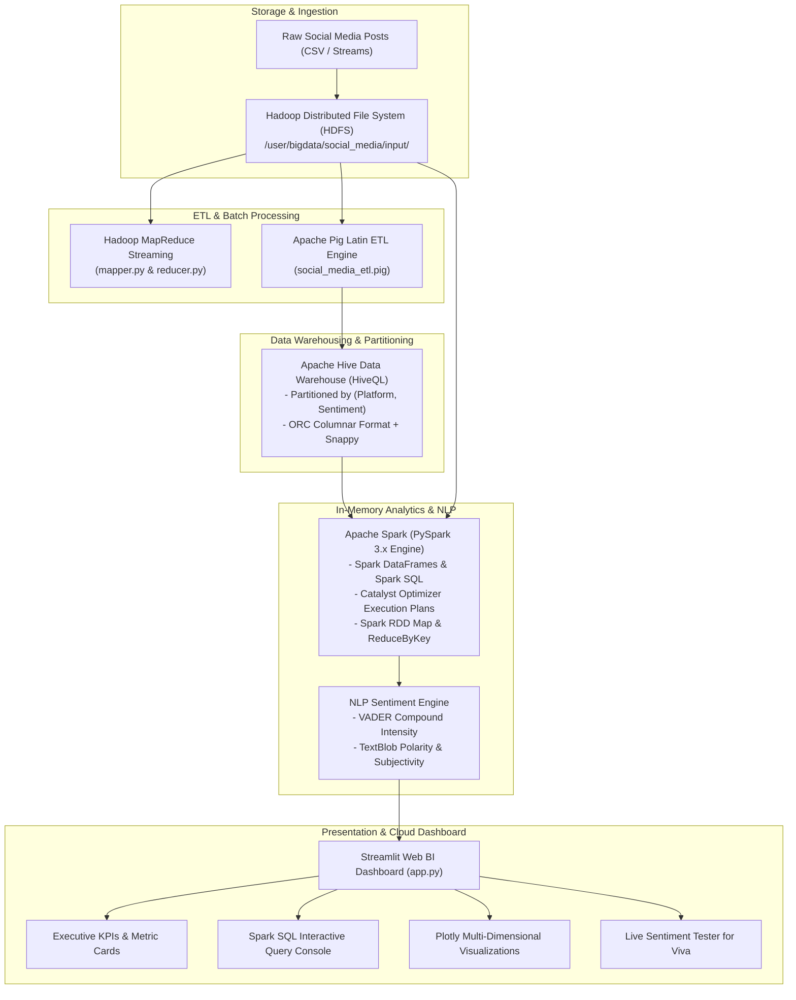

# Social Media Analytics Using Big Data & Python
## (Apache Spark • Apache Hive • Apache Pig • Hadoop)

[](https://github.com/ShaikSanaFarooha/Social-Media-Analytics/actions)
[](https://share.streamlit.io)

**Academic Domain:** Big Data Analytics & Artificial Intelligence  
**Project Category:** B.Tech Computer Science and Engineering (Artificial Intelligence) Mini-Project  
**Author:** Shaik Sana Farooha  
**Frontend Framework:** Streamlit  
**Big Data Stack:** Apache Spark (PySpark), Apache Hive (HiveQL), Apache Pig (Pig Latin), Hadoop (HDFS & MapReduce)  
**Core Technologies:** Python, Pandas, NumPy, VADER, TextBlob, Plotly, Matplotlib, WordCloud  

---

## 1. Abstract
In today's digital era, social media platforms (X/Twitter, Instagram, Facebook) generate massive volumes of unstructured and semi-structured user-generated data every second. Extracting actionable insights from this high-velocity, high-volume data is a fundamental problem in **Big Data Analytics**. 

This mini-project presents a complete, enterprise-grade, and beginner-friendly **Big Data Social Media Analytics System** integrating the full Hadoop ecosystem and modern distributed computing engines:
- **Hadoop (HDFS & MapReduce):** Fault-tolerant distributed storage and Python MapReduce Streaming pipeline.
- **Apache Pig:** Declarative **Pig Latin** dataflow script for Extract, Transform, Load (ETL) processing.
- **Apache Hive:** Distributed Data Warehouse schema with **HiveQL**, partitioned ORC storage, and ad-hoc analytical queries.
- **Apache Spark (PySpark):** In-memory distributed data processing, **Catalyst Query Optimizer**, **Spark SQL**, and **Spark RDD** transformations.
- **Interactive BI & NLP:** Automated data cleaning, VADER/TextBlob sentiment classification, hashtag extraction, and interactive Streamlit web dashboard.

---

## 2. Big Data Architecture & Pipeline



---

## 3. Big Data Ecosystem Components

### 1. 🐘 Hadoop (HDFS & MapReduce)
- **HDFS Ingestion:** Raw social media CSV records are partitioned and stored in HDFS across data nodes with default 3x block replication.
- **MapReduce Streaming (`hadoop/mapper.py` & `hadoop/reducer.py`):**
  - **Mapper:** Reads social media records, extracts hashtags (`#\w+`), platforms, and tokens, emitting `(token, 1)`.
  - **Shuffle & Sort:** Hadoop groups emitted keys across cluster nodes.
  - **Reducer:** Aggregates and sums identical keys, outputting final token counts to HDFS.
- **Run Script:** `hadoop/run_mapreduce.sh`

### 2. 🐷 Apache Pig (Pig Latin ETL)
- **ETL Script (`pig/social_media_etl.pig`):**
  - `LOAD`: Loads comma-separated records from HDFS into strongly-typed Pig tuples.
  - `FILTER`: Prunes corrupted records and header rows.
  - `FOREACH ... GENERATE`: Computes `Total_Engagement = (likes + comments + shares)`.
  - `GROUP BY`: Aggregates metrics per platform.
  - `ORDER BY & LIMIT`: Isolates high-engagement viral content.
  - `STORE`: Writes structured output bags back into HDFS storage directories.
- **Run Script:** `pig/run_pig.sh`

### 3. 🐝 Apache Hive (HiveQL Data Warehouse)
- **Data Warehouse Script (`hive/social_media_analytics.hql`):**
  - **Database:** `CREATE DATABASE IF NOT EXISTS social_media_dw;`
  - **External Raw Table:** Points directly to HDFS storage with OpenCSVSerde.
  - **Managed Partitioned Table:** `partitioned_social_analytics` partitioned by `(platform_name, sentiment_category)` stored in high-performance **ORC (Optimized Row Columnar)** format with Snappy compression.
  - **Analytical HiveQL Queries:** Top influencers, platform engagement benchmarks, and virality multipliers using SQL window functions (`OVER()`).

### 4. ⚡ Apache Spark (PySpark)
- **Distributed Engine (`modules/spark_processing.py`):**
  - **SparkSession:** Configured in local cluster mode (`master("local[*]")`).
  - **Spark SQL:** Runs distributed SQL queries over in-memory PySpark DataFrames.
  - **Catalyst Optimizer:** Generates and displays parsed logical, analyzed logical, optimized logical, and physical execution plans (`df.explain()`).
  - **Spark RDD Transformations:** Demonstrates `sc.parallelize() -> flatMap() -> map() -> reduceByKey() -> sortBy()`.

---

## 4. Project Folder Structure

```text
social_media_analytics/
│
├── app.py                      # Streamlit BI Dashboard with Big Data Console
├── generate_dataset.py         # Realistic sample dataset generator (235 posts)
├── requirements.txt            # Python & Big Data dependencies list
├── README.md                   # Project documentation
├── PROJECT_REPORT.md           # Formal Academic B.Tech Mini-Project Report
│
├── data/
│   └── social_media_data.csv   # Pre-generated sample dataset (235 posts)
│
├── hadoop/
│   ├── mapper.py               # Hadoop Streaming Mapper in Python
│   ├── reducer.py              # Hadoop Streaming Reducer in Python
│   └── run_mapreduce.sh        # Hadoop cluster submission shell script
│
├── pig/
│   ├── social_media_etl.pig    # Apache Pig Latin ETL & aggregation pipeline
│   └── run_pig.sh              # Apache Pig execution shell script
│
├── hive/
│   └── social_media_analytics.hql  # HiveQL schema DDL & analytical queries
│
└── modules/
    ├── __init__.py             # Module package initializer
    ├── data_processing.py      # Data cleaning, KPI computation, hashtags & words
    ├── sentiment_analysis.py   # VADER & TextBlob NLP sentiment engine
    ├── spark_processing.py     # PySpark SparkSession, Spark SQL, RDD & Catalyst
    └── visualization.py        # Interactive Plotly, Matplotlib & WordCloud figures
```

---

## 5. Dashboard Features Walkthrough

1. **📊 Overview & Summary:** 6 top executive KPI cards (Total Posts, Likes, Comments, Shares, Engagement, Net Sentiment), sentiment donut chart, and platform comparison.
2. **🐘 Big Data Tools (Spark, Hive, Pig, Hadoop):**
   - **PySpark Tab:** Live Spark SQL query editor (run custom queries), Spark Catalyst execution plan viewer, and RDD transformation pipeline.
   - **Hive Tab:** HiveQL table creation script, partitioned ORC storage, and live SQL execution results.
   - **Pig Tab:** Full Pig Latin dataflow script with operator breakdowns (LOAD, FILTER, FOREACH, GROUP, STORE).
   - **Hadoop Tab:** MapReduce Mapper & Reducer source code with **Live MapReduce Simulation** button.
3. **🔍 Data Exploration & Cleaning:** Data quality audit, null checks, deduplication stats, and descriptive statistics.
4. **💬 Sentiment Analysis:** Positive/Neutral/Negative percentage distributions, polarity histograms, and sample posts inspector.
5. **#️⃣ Hashtags & Trending Topics:** Top 10 hashtags chart, trending words frequency, and visual **Word Cloud**.
6. **📈 User Engagement Analytics:** Multi-dimensional scatter/bubble chart, active influencers leaderboard, and platform engagement box plots.
7. **🧪 Live Sentiment Tester (For Viva):** Interactive NLP sandbox to test any sentence or tweet in real time!
8. **📥 Dataset Preview & Download:** Full table viewer and one-click export of analyzed data to CSV.

---

## 6. How to Run the Project Locally

```powershell
# 1. Open the project folder in VS Code
cd c:\Users\Sana\Documents\Social_Media_Analytics

# 2. Run the Streamlit Dashboard
streamlit run app.py
```
*(or via npm: `npm run dev`)*

---

## 7. Cloud Deployment & Live Link

The application is deployed on **Streamlit Community Cloud** and synchronized with GitHub:
👉 **GitHub Repository:** [https://github.com/ShaikSanaFarooha/Social-Media-Analytics](https://github.com/ShaikSanaFarooha/Social-Media-Analytics)
