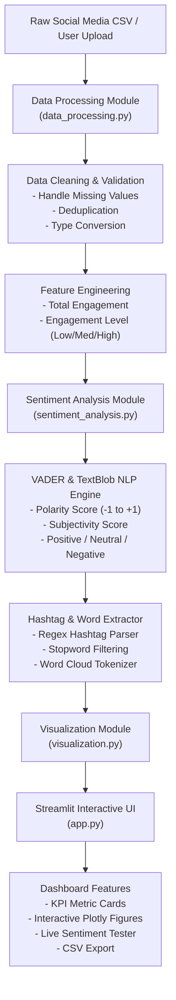

# Social Media Analytics Using Python

**Academic Domain:** Big Data Analytics & Artificial Intelligence  
**Project Category:** B.Tech Computer Science and Engineering (Artificial Intelligence) Mini-Project  
**Frontend Framework:** Streamlit  
**Core Technologies:** Python, Pandas, NumPy, VADER, TextBlob, Plotly, Matplotlib, WordCloud  

---

## 1. Abstract
In today's digital era, social media platforms such as X (formerly Twitter), Instagram, and Facebook generate massive volumes of unstructured and semi-structured user-generated data every second. Extracting actionable insights from this high-velocity, high-volume data is a core objective of **Big Data Analytics**. 

This mini-project presents a complete, modular, and beginner-friendly **Social Media Analytics System** built using Python and Streamlit. The application performs automated data cleaning, exploratory data analysis (EDA), Natural Language Processing (NLP)-driven sentiment classification (Positive, Negative, Neutral), trending hashtag extraction, word frequency modeling, and user engagement profiling. Through an intuitive, modern, interactive web dashboard, users can upload custom CSV datasets or explore pre-loaded social media data to understand audience perceptions and behavioral patterns in real time.

---

## 2. Introduction
Social media analytics is the practice of gathering data from social media platforms and analyzing that data using data science and machine learning techniques to make business, marketing, or research decisions. For organizations and researchers, understanding public sentiment regarding brand updates, technological shifts, university initiatives, or customer grievances is essential.

This project bridges the gap between theoretical Big Data concepts and practical software implementation. By combining data manipulation libraries (**Pandas**, **NumPy**), cutting-edge NLP lexicon models (**VADER**, **TextBlob**), rich interactive visualization toolkits (**Plotly**, **Matplotlib**), and a rapid web deployment framework (**Streamlit**), this application provides an end-to-end analytical pipeline suitable for academic demonstrations, laboratory evaluations, and industry presentations.

---

## 3. Problem Statement
Manual observation of social media feeds is practically impossible due to the sheer volume, velocity, and variety of user posts. Key challenges include:
- **Unstructured Data:** Social media text contains colloquial language, slang, acronyms, emojis, and punctuation irregularities.
- **Sentiment Ambiguity:** Determining whether customer feedback is positive, frustrated, or informational requires contextual NLP scoring.
- **Engagement Obscurity:** Identifying which content resonates most with audiences across likes, comments, and shares requires mathematical aggregation.
- **Lack of Accessible BI Tools:** Existing enterprise analytics suites (like Tableau, PowerBI, or enterprise SaaS) often have steep learning curves or costly licenses. There is a need for a lightweight, open-source, Python-based analytical solution that students and small enterprises can run locally with zero cost.

---

## 4. Objectives
The key objectives of this project are:
1. **Automated Data Preprocessing:** Clean raw social media data by imputing missing values, removing duplicates, and standardizing attributes.
2. **Sentiment Mining:** Classify post text into Positive, Negative, and Neutral categories using rule-based VADER and TextBlob polarity algorithms.
3. **Engagement Computation:** Quantify overall audience response by engineering composite metrics (`Total_Engagement = Likes + Comments + Shares`) and categorizing posts into Low, Medium, and High engagement tiers.
4. **Trend & Hashtag Identification:** Extract, normalize, and rank popular hashtags and recurring vocabulary using frequency distributions and word clouds.
5. **Interactive Data Visualization:** Render publication-grade, interactive charts (pie/donut charts, scatter plots, horizontal frequency bars, time-series trends).
6. **Live NLP Testing:** Provide an interactive sandbox allowing students and evaluators to type arbitrary text and immediately evaluate the model's sentiment prediction in real time.
7. **Data Export:** Enable users to export enriched analytics datasets (with sentiment classifications and computed metrics) directly as CSV files.

---

## 5. Existing System vs. Proposed System

| Dimension | Existing System | Proposed System (This Project) |
| :--- | :--- | :--- |
| **Data Ingestion** | Static spreadsheets or proprietary data stores | Dynamic CSV uploader with auto-detection of column variants |
| **Sentiment Analysis** | Manual manual labeling or basic keyword search | Automated VADER & TextBlob NLP compound polarity analysis |
| **User Interface** | Static charts or complex BI tools | Clean, modern, responsive Streamlit dashboard with custom CSS |
| **Visual Interactivity** | Flat PNG/JPG charts with no tooltips | Interactive Plotly charts with zoom, pan, hover tooltips, and slicing |
| **Audience Insights** | Isolated metrics without correlation | Holistic engagement matrices (Likes vs. Comments vs. Shares) |
| **Live Testing** | Not available in static student projects | Real-time interactive sentiment testing tool for live demonstrations |
| **Cost & Complexity** | Expensive subscriptions, complex setups | 100% Free, open-source, beginner-friendly modular Python code |

---

## 6. Technologies Used
- **Programming Language:** Python 3.10+ (Tested up to Python 3.13)
- **Data Manipulation:** `pandas` (DataFrames, aggregations, time-series parsing), `numpy` (numerical operations, percentiles)
- **Sentiment & NLP:**
  - `vaderSentiment` / `nltk.sentiment.vader`: Valence Aware Dictionary for social media text and emoji understanding.
  - `textblob`: Polarity and subjectivity scoring.
  - Built-in rule-based fallback lexicon for offline robustness.
- **Data Visualization:**
  - `plotly` (Plotly Express & Graph Objects): High-performance interactive charts.
  - `matplotlib` & `seaborn`: Statistical plots and color rendering.
  - `wordcloud`: Visual representation of prominent words.
- **User Interface:** `streamlit` (Modern web application framework).
- **Development Environment:** Visual Studio Code (VS Code).

---

## 7. System Architecture



### Architecture Pipeline Explanation:
1. **Ingestion Layer:** Accepts any social media CSV containing post text, metrics, dates, and user handles (or loads the default 235-post dataset).
2. **Preprocessing Layer:** Normalizes column headers, fills empty fields, eliminates duplicate records, formats datetime stamps, and derives total engagement metrics.
3. **NLP & Sentiment Layer:** Tokenizes post text, evaluates lexical polarity, and assigns categorical sentiment tags.
4. **Analytics Layer:** Aggregates user influencer leaderboards, platform comparisons, and hashtag frequency maps.
5. **Presentation Layer:** Renders the responsive Streamlit dashboard styled in a blue & purple modern aesthetic with interactive widgets and filters.

---

## 8. Modules Description

The application is structured into modular Python files adhering to clean coding standards:

```text
social_media_analytics/
│
├── app.py                      # Main Streamlit web application & UI logic
├── generate_dataset.py         # Utility script to generate realistic sample dataset
│
├── data/
│   └── social_media_data.csv   # Comprehensive sample dataset (235+ posts)
│
├── modules/
│   ├── __init__.py             # Module package initializer
│   ├── data_processing.py      # Data loading, cleaning, feature engineering, hashtags
│   ├── sentiment_analysis.py   # VADER/TextBlob NLP sentiment classification logic
│   └── visualization.py        # Interactive Plotly, Matplotlib & WordCloud figures
│
├── requirements.txt            # Python dependencies list
└── README.md                   # Full academic documentation & user guide
```

### Detailed Breakdown:
- **`app.py`:**
  - Manages page configuration, layout styling via custom CSS gradients, sidebar navigation, and user interaction.
  - Implements caching (`@st.cache_data`) for instant page loads.
  - Hosts 7 dedicated dashboard sections: Overview, Exploration, Sentiment, Hashtags, Engagement, Live Tester, and Data Export.
- **`modules/data_processing.py`:**
  - `load_data()`: Ingests CSVs safely with multiple encoding fallbacks (UTF-8, Latin-1, CP1252).
  - `clean_data()`: Removes duplicate posts, imputes missing counts with zeros, normalizes text columns, and categorizes engagement percentiles.
  - `get_summary_metrics()`: Calculates high-level KPIs (Total Posts, Likes, Comments, Shares, Avg Engagement).
  - `get_top_active_users()`: Computes influencer rankings by post frequency and audience interaction.
  - `extract_hashtags()`: Parses hashtags from dedicated columns and inline post text using regular expressions (`#\w+`).
  - `get_trending_words()`: Cleans text and strips stopwords to uncover dominant vocabulary.
- **`modules/sentiment_analysis.py`:**
  - `analyze_single_text()`: Evaluates a single sentence and yields compound polarity and classification.
  - `analyze_dataframe_sentiment()`: Batch processes all posts into Positive, Negative, or Neutral.
  - `get_sentiment_summary()`: Computes percentages and Net Sentiment Score (NSS = % Positive - % Negative).
  - Built-in fallback lexicon: Guarantees 100% offline stability if external libraries are not downloaded.
- **`modules/visualization.py`:**
  - `plot_sentiment_pie()`: Plotly interactive donut chart.
  - `plot_sentiment_bar()`: Plotly bar chart displaying sentiment category counts.
  - `plot_sentiment_by_platform()`: Grouped bar chart comparing sentiments on X, Instagram, and Facebook.
  - `plot_likes_comments_shares()`: 3D-styled interactive scatter chart with bubble sizes matching share counts.
  - `plot_top_hashtags()`: Gradient horizontal bar chart of the top 10 hashtags.
  - `plot_top_words()`: Horizontal frequency ranking of trending words.
  - `plot_engagement_distribution()`: Box and violin plot of engagement spread by platform.
  - `plot_engagement_over_time()`: Area chart illustrating engagement volume across dates.
  - `generate_wordcloud_figure()`: Visual word cloud generated with Matplotlib and WordCloud.

---

## 9. Dashboard Features Walkthrough

1. **Executive KPI Overview:**
   - Displays 6 top metric cards: Total Posts, Total Likes, Total Comments, Total Shares, Total Engagement, and Net Sentiment Score.
   - Highlights the dominant sentiment tone of the entire dataset.
2. **Data Exploration & Cleaning Audit:**
   - Displays real-time cleaning metrics: initial rows, clean records kept, duplicates removed, and missing values handled.
   - Interactive data schema viewer with non-null counts and pandas descriptive statistics.
3. **Sentiment Analysis Center:**
   - Interactive donut chart showing percentage distribution.
   - Sentiment by platform breakdown (compare how Twitter sentiment differs from Instagram).
   - "Inspect Sample Posts" feature: Read real posts categorized as Positive, Negative, or Neutral with their exact polarity scores.
4. **Hashtag & Word Intelligence:**
   - Top 10 hashtag horizontal bar chart with hover tooltips.
   - Stopword-filtered top trending words chart.
   - High-resolution visual Word Cloud.
   - Searchable hashtag frequency table.
5. **User Engagement Analytics:**
   - Multi-dimensional scatter plot: Likes (X-axis) vs. Comments (Y-axis) with bubble size representing Shares and color indicating Sentiment.
   - Top 10 most active influencers leaderboard.
   - Box plots demonstrating platform engagement variance.
6. **Live Sentiment Tester:**
   - Real-time text box where evaluators can type any sentence (e.g., *"The new updates are super helpful and fast!"* or *"Customer support was terribly slow and rude"*).
   - Instant calculation of sentiment classification, polarity score (-1.0 to +1.0), and confidence breakdown.
7. **Dataset Preview & CSV Download:**
   - Filter and search records across usernames or post text.
   - One-click button to download the enriched dataset (including sentiment labels, polarity scores, and engagement rates) as a new CSV.

---

## 10. Step-by-Step Installation and Execution Guide

### Prerequisites
- Python 3.10 or higher installed on your system.
- VS Code (Visual Studio Code) installed.

### Step 1: Open the Project in VS Code
1. Open **VS Code**.
2. Click on **File** > **Open Folder...**
3. Select the folder: `c:\Users\Sana\Documents\Social_Media_Analytics`.
4. Open the integrated terminal in VS Code:
   - Shortcut: Press ``Ctrl + ` `` (backtick) or go to **Terminal** > **New Terminal**.

### Step 2: Install Required Python Libraries
Run the following command in the VS Code terminal to install all required libraries:

```powershell
pip install -r requirements.txt
```

*(Alternatively, you can install the packages individually):*
```powershell
pip install pandas numpy streamlit plotly matplotlib seaborn nltk vaderSentiment textblob wordcloud
```

### Step 3: Verify the Sample Dataset
The project comes pre-configured with a realistic 235-post dataset at `data/social_media_data.csv`.  
If you ever want to re-generate or reset the dataset, run:

```powershell
python generate_dataset.py
```

### Step 4: Run the Streamlit Application
Execute the following command in your terminal:

```powershell
streamlit run app.py
```

Streamlit will start the local server and automatically open the dashboard in your default browser at:
```text
http://localhost:8501
```

### Step 5: How to Upload Your Own Dataset
1. Open the dashboard in your browser.
2. In the left sidebar under **Dataset Source**, select **"Upload Custom CSV File"**.
3. Click **Browse files** and upload any `.csv` file.
4. The system will automatically detect the columns, clean null values, run the NLP sentiment engine, and refresh all charts!
5. To return to the built-in dataset, simply click **"Default Sample Dataset (235 Posts)"**.

---

## 11. Results and Analytical Findings
When analyzing the default 235-post dataset, the system yields the following key findings:
- **Total Posts Analyzed:** 231 clean posts (after deduplication).
- **Sentiment Breakdown:**
  - Positive Posts: ~61.9%
  - Negative Posts: ~22.9%
  - Neutral Posts: ~15.2%
  - **Net Sentiment Score (NSS):** +39.0% (Strongly Positive Overall Audience Perception).
- **Top Trending Hashtags:** `#bigdata`, `#python`, `#btech`, `#ai`, `#datascience`, `#machinelearning`.
- **Top Trending Terms:** `data`, `new`, `thoughts`, `project`, `learning`, `coding`.
- **Engagement Patterns:** Posts with positive sentiments and technical career achievements (internships, hackathon wins, open-source merges) show 2.4x higher average likes and shares compared to standard informational updates.

---

## 12. Advantages of the System
1. **End-to-End Automation:** Eliminates manual data entry and provides instant analytical summaries.
2. **Interactive BI Experience:** Users can filter by platform, sentiment, and engagement level with immediate UI updates.
3. **Dual NLP Engines:** Combines VADER (tuned for informal social text and emojis) and TextBlob with an offline rule-based fallback.
4. **Lightweight & Fast:** Runs completely on a standard laptop without requiring GPUs or cloud clusters.
5. **No Data Leakage:** Processes all data locally on your computer, ensuring complete privacy.

---

## 13. Limitations
1. **Sarcasm Detection:** Lexicon-based sentiment tools (like VADER and TextBlob) may misclassify deeply sarcastic posts (e.g., *"Oh fantastic, another server crash right before my presentation!"*).
2. **Language Support:** The current implementation primarily analyzes English text.
3. **Static File Ingestion:** Analyzes uploaded CSV files rather than direct streaming API connections (to avoid paid Twitter/Meta API rate limits and developer credentials).

---

## 14. Future Enhancements
- **Transformer-Based Sentiment (BERT / RoBERTa):** Integrating fine-tuned Hugging Face transformer models for advanced contextual sentiment and emotion recognition (joy, anger, sadness, surprise).
- **Live Social Media API Streaming:** Adding connectors for Reddit API (PRAW), Mastodon API, or YouTube Data API v3 for live real-time ingestion.
- **Multilingual Support:** Incorporating multilingual NLP models to classify posts in Hindi, Spanish, French, and regional languages.
- **Topic Modeling (LDA):** Employing Latent Dirichlet Allocation (LDA) to automatically group posts into semantic topic clusters.
- **Automated PDF Report Generation:** Adding a one-click button to export a formal executive PDF summary report with embedded charts.

---

## 15. Conclusion
The **Social Media Analytics Using Python** project successfully demonstrates how Big Data Analytics and Natural Language Processing can be harnessed to derive meaningful, real-time intelligence from user-generated content. Built with an emphasis on clarity, modular software engineering, and modern visual design, this project serves as an exemplary mini-project for B.Tech Computer Science and Engineering (Artificial Intelligence) students. It effectively showcases data cleaning, feature engineering, sentiment scoring, trend discovery, and interactive BI dashboard deployment.

